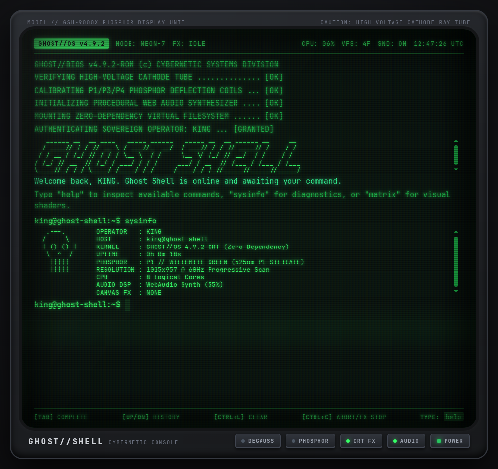

# GHOST SHELL // GSH-9000X CRT TERMINAL EMULATOR

[](https://github.com/tahaenasraoui-debug/ghost-shell/actions/workflows/ci.yml)
[](LICENSE)


**Ghost Shell** is a zero-dependency, retro-futuristic cathode-ray tube (CRT) terminal emulator that runs entirely in the browser. Built from scratch with TypeScript, HTML5 Canvas, the native Web Audio API, and scoped CSS, it features real-time procedural sound synthesis, optical phosphor filters, interactive Canvas shaders, an in-memory virtual filesystem, and a custom command-line parser.

---

## Preview



---

## Table of Contents

1. [Quick Start](#quick-start)
2. [How It Works (System Architecture)](#how-it-works-system-architecture)
3. [Hardware Bezel & Keyboard Shortcuts](#hardware-bezel--keyboard-shortcuts)
4. [Complete Command Reference](#complete-command-reference)
   - [System & Virtual Filesystem Commands](#1-system--virtual-filesystem-commands)
   - [Visual, CRT & Audio Commands](#2-visual-crt--audio-commands)
   - [Utility, Math & Cryptography Commands](#3-utility-math--cryptography-commands)
5. [Project Structure](#project-structure)

---

## Quick Start

### Prerequisites
- **Node.js** `>= 20.0.0`
- **npm** `>= 9.0.0`

### Installation & Local Development

```bash
# Clone the repository
git clone https://github.com/tahaenasraoui-debug/ghost-shell.git
cd ghost-shell

# Install development dependencies (Vite, TypeScript, Vitest, ESLint)
npm install

# Start the local development server on http://localhost:3000
npm run dev

# Run ESLint check
npm run lint

# Run strict TypeScript type verification
npm run typecheck

# Run unit tests
npm test

# Build optimized production bundle to ./dist
npm run build

# Preview production build locally
npm run preview
```

---

## How It Works (System Architecture)

Ghost Shell avoids external terminal libraries (`xterm.js`), UI frameworks, and pre-recorded audio assets. Every visual and auditory detail is computed mathematically at runtime.

### 1. Procedural Web Audio Synthesizer (`src/core/audio.ts`)
All sound effects are generated in real time using the browser's native `AudioContext`:
- **Cathode Mains Hum & Fan Warmth:** Combines a continuous `60Hz` sine wave oscillator, a `120Hz` triangle harmonic, and lowpass-filtered white noise (`260Hz` cutoff) to emulate transformer hum and enclosure airflow.
- **Mechanical Switch Synthesis:** Every keystroke layers two distinct physical transients with randomized pitch jitter (`±6%`):
  1. *Switch Click:* A `22ms` white-noise burst routed through a resonant bandpass filter (`1250Hz–1950Hz`, `Q = 3.2`).
  2. *Keycap Bottom-Out ("Thock"):* A triangle wave oscillator that rapidly pitch-drops down to `52Hz` over `45ms`. Spacebar, Enter, Backspace, and standard keys each use distinct frequency profiles.
- **Magnetic Degauss Pulse:** Combines a pitch-dropping sawtooth sub-bass thump (`145Hz -> 38Hz`) with a metallic sine ring (`520Hz -> 110Hz`) when discharging the screen coil.
- **Real-Time Waveform Analysis:** Routes master audio output through an `AnalyserNode` (`fftSize = 512`) so the `scope` command can draw live time-domain audio waveforms onto the CRT canvas.

### 2. Optical CRT & Phosphor Engine (`src/effects/crt.css`)
The monitor chassis and glass tube use layered CSS composites:
- **Five Authentic Phosphor Coatings:** Driven by `[data-theme]` CSS custom properties that dynamically re-color text glow, scanbars, scrollbars, and HTML5 Canvas shaders:
  - `green` — **P1 Willemite Green** (`525nm`)
  - `amber` — **P3 Monochrome Amber** (`590nm`)
  - `cyan` — **P4 Cybernetic Cyan** (`485nm`)
  - `magenta` — **P7 Synthwave Magenta** (`615nm`)
  - `white` — **P45 Paper White** (`545nm`)
- **Scanlines & RGB Aperture Grille:** Uses `repeating-linear-gradient` overlays for horizontal scanlines and vertical sub-pixel RGB shadow masks, paired with a rolling `60Hz` refresh bar and radial glass vignette.
- **Hardware Degauss & Glitch Animations:** CSS keyframe transforms apply skew, scale, hue-rotation, and RGB chromatic aberration (`text-shadow` splitting) on demand.

### 3. HTML5 Canvas Shader Pipeline (`src/core/terminal.ts`)
An underlying `<canvas id="fx-canvas">` layer runs at 60 FPS via `requestAnimationFrame` and automatically syncs its color palette with the active phosphor theme:
- **Matrix (`matrix`):** Procedural Katakana and hexadecimal rain columns with variable drop velocities.
- **Oscilloscope (`scope`):** Renders a graticule grid and plots live Web Audio API time-domain samples mixed with a dual-sine carrier wave.
- **Starfield (`starfield`):** 3D perspective projection (`x/z`, `y/z`) simulating warp-speed navigation.
- **Plasma (`plasma`):** Demoscene interference field computed from four overlapping trigonometric wave functions.

### 4. Command Parser, Fuzzy Matcher & Virtual Filesystem (`src/core/commandRegistry.ts`)
- **Tokenizer:** Parses raw input strings into command names, positional arguments, long flags (`--flag=value` or `--flag value`), and stacked short flags (`-tc`), while respecting quoted strings and escape sequences (`\"`).
- **Inline Ghost Autocomplete:** Evaluates partial commands, subcommands, theme names, and virtual filenames in real time, rendering a dimmed inline preview that can be accepted with `Tab` or `Right Arrow`.
- **Levenshtein Typo Suggestion:** When an unknown command is entered, the registry computes the Levenshtein edit distance against all registered commands and aliases, suggesting the closest match if the distance is `<= 2`.
- **Virtual Filesystem (VFS):** Stores files in memory with simulated POSIX permissions, byte sizes, and modification timestamps.

### 5. Zero-`eval()` Recursive-Descent Math Engine (`src/commands/utility.ts`)
The `calc` command uses a custom recursive-descent parser (`SafeMathEvaluator`) rather than JavaScript's `eval()`. It respects operator precedence (`()`, unary `+/-`, `^`, `*/%`, `+-`), detects division by zero, and supports mathematical constants (`pi`, `e`) and functions (`sqrt`, `sin`, `cos`, `tan`, `abs`, `log`, `ln`, `round`).

---

## Hardware Bezel & Keyboard Shortcuts

### Keyboard Shortcuts

| Shortcut | Action |
| :--- | :--- |
| `Tab` | Autocomplete current command, subcommand, theme, or filename |
| `Right Arrow` | Move cursor right, or accept the dimmed inline ghost suggestion |
| `Up / Down Arrow` | Navigate persistent command history (stored in `localStorage`) |
| `Home / End` | Jump cursor to the start or end of the input line |
| `Ctrl + L` | Clear the terminal viewport buffer immediately |
| `Ctrl + C` | Abort active typewriter output, halt active Canvas shaders, or cancel line |
| `Ctrl + U` | Clear the current input buffer from cursor to start |

### Physical Bezel Buttons

| Bezel Button | Function |
| :--- | :--- |
| **DEGAUSS** | Fires the magnetic degaussing coil (screen warp animation + sub-bass discharge) |
| **PHOSPHOR** | Cycles through the 5 phosphor coatings (`green` -> `amber` -> `cyan` -> `magenta` -> `white`) |
| **CRT FX** | Toggles scanlines, RGB aperture grille, and 60Hz flicker filters on or off |
| **AUDIO** | Toggles the procedural Web Audio synthesizer and ambient cathode hum |
| **POWER** | Collapses or restores the CRT cathode beam and powers down the display |

---

## Complete Command Reference

### 1. System & Virtual Filesystem Commands

| Command | Aliases | Usage | Description |
| :--- | :--- | :--- | :--- |
| `help` | `?`, `man` | `help [command]` | List all commands or inspect a specific command's manual |
| `clear` | `cls` | `clear` | Clear the terminal phosphor viewport buffer |
| `sysinfo` | `neofetch`, `status` | `sysinfo` | Display ASCII crest, hardware telemetry, uptime, and phosphor specs |
| `whoami` | `id` | `whoami` | Print active operator identity (`king`) and security clearance |
| `ls` | `dir` | `ls` | List all files in the virtual filesystem with permissions and byte sizes |
| `cat` | `read`, `type` | `cat <filename>` | Print the contents of a virtual file |
| `write` | `touch` | `write <file> <text>` | Create or overwrite a file in the virtual filesystem |
| `rm` | `del` | `rm <filename>` | Delete a file from the virtual filesystem |
| `env` | `export` | `env [KEY=VALUE]` | List all shell environment variables or set a new variable |
| `history` | — | `history [--clear]` | Display persistent command history or purge it with `--clear` |
| `reboot` | `restart` | `reboot` | Re-run the full BIOS boot sequence and audio chord |

**System Command Examples:**
```bash
help calc
sysinfo
ls
cat manifesto.txt
write mission.log "Uplink established on node NEON-7"
env SECTOR=RABAT-CORE
history --clear
```

---

### 2. Visual, CRT & Audio Commands

| Command | Aliases | Usage | Description |
| :--- | :--- | :--- | :--- |
| `theme` | `phosphor`, `color` | `theme [name]` | Switch CRT phosphor (`green`, `amber`, `cyan`, `magenta`, `white`) |
| `crt` | — | `crt [on\|off\|toggle]` | Enable, bypass, or toggle CRT scanline and aperture filters |
| `degauss` | — | `degauss` | Discharge the electromagnetic screen degaussing coil |
| `glitch` | — | `glitch [ms]` | Inject a chromatic aberration signal interference burst (`150–2000ms`) |
| `matrix` | `rain` | `matrix [stop]` | Launch procedural Katakana digital rain on the background Canvas |
| `scope` | `oscilloscope`, `wave` | `scope [stop]` | Launch real-time Web Audio waveform oscilloscope on the Canvas |
| `starfield` | `warp` | `starfield [stop]` | Launch 3D vector starfield warp simulation on the Canvas |
| `plasma` | — | `plasma [stop]` | Launch retro demoscene trigonometric plasma shader on the Canvas |
| `fx` | `stopfx` | `fx <mode\|stop>` | Switch Canvas shader mode or halt all active Canvas shaders |
| `audio` | `sound`, `mute` | `audio [on\|off\|vol\|test]` | Mute/unmute synthesizer, set volume (`0–100`), or play test chord |
| `banner` | `logo` | `banner <text>` | Render block ASCII typography (up to 14 characters) |

**Visual & Audio Examples:**
```bash
theme amber
scope
audio vol 80
audio test
banner KING
glitch 800
fx stop
```

---

### 3. Utility, Math & Cryptography Commands

| Command | Aliases | Usage | Description |
| :--- | :--- | :--- | :--- |
| `echo` | `print` | `echo [-t] <text>` | Print text with `$ENV` variable expansion and optional `-t` typewriter mode |
| `date` | `time`, `uptime` | `date` | Print local time, UTC ISO timestamp, Unix epoch, and session uptime |
| `calc` | `math` | `calc <expr>` | Evaluate math expressions (`+`, `-`, `*`, `/`, `%`, `^`, `sqrt`, `sin`, `cos`, `pi`) |
| `hash` | `crypto`, `encode` | `hash <algo> <text>` | Encode or hash text via `sha256`, `base64`, `hex`, `rot13`, or `binary` |
| `hex` | `hexdump` | `hex <file\|text>` | Generate a 16-byte offset hexadecimal + ASCII dump of a file or string |
| `scan` | `ping`, `trace` | `scan [host]` | Run an animated subnet relay and port diagnostic sweep |
| `weather` | `atmos` | `weather [sector]` | Display atmospheric telemetry for a given sector |

**Utility & Crypto Examples:**
```bash
echo --typewriter "Operator $USER authenticated on node $NODE_ID"
calc "(128 * 4) + sqrt(1024)"
calc "2 ^ 16"
hash sha256 "Ghost Shell"
hash base64 "KING"
hex security.key
scan 10.244.8.1
```

---

## Project Structure

```text
ghost-shell/
├── .github/workflows/ci.yml  # GitHub Actions CI pipeline
├── .editorconfig             # Cross-editor formatting defaults
├── .prettierrc               # Prettier formatting configuration
├── eslint.config.mjs         # ESLint flat config for TypeScript
├── LICENSE                   # MIT License
├── package.json              # Scripts & devDependencies
├── package-lock.json         # Deterministic dependency lockfile
├── tsconfig.json             # Strict ES2022 + DOM TypeScript configuration
├── vite.config.ts            # Vite bundler & dev server configuration
├── index.html                # CRT monitor chassis, HUD telemetry, & bezel DOM
├── README.md                 # Architecture & command documentation
├── assets/
│   └── screenshot.png        # CRT terminal preview screenshot
├── tests/                    # Vitest unit & integration test suites
│   ├── commandRegistry.test.ts
│   ├── terminal.test.ts
│   └── vfs.test.ts
└── src/
    ├── types.ts              # Shared TypeScript interfaces & state contracts
    ├── main.ts               # Application bootstrap & hardware bezel wiring
    ├── effects/
    │   └── crt.css           # Scoped CRT scanlines, phosphor themes, & animations
    ├── core/
    │   ├── audio.ts          # Procedural Web Audio API sound synthesizer
    │   ├── commandRegistry.ts# Tokenizer, flag parser, autocomplete, & fuzzy matcher
    │   └── terminal.ts       # Viewport controller, VFS, & HTML5 Canvas shader loop
    └── commands/
        ├── system.ts         # System, VFS, environment, & diagnostic commands
        ├── visual.ts         # Phosphor themes, Canvas shaders, & audio commands
        └── utility.ts        # Safe math parser, hashing, hexdump, & network tools
```

---

## License

Distributed under the [MIT License](LICENSE).
